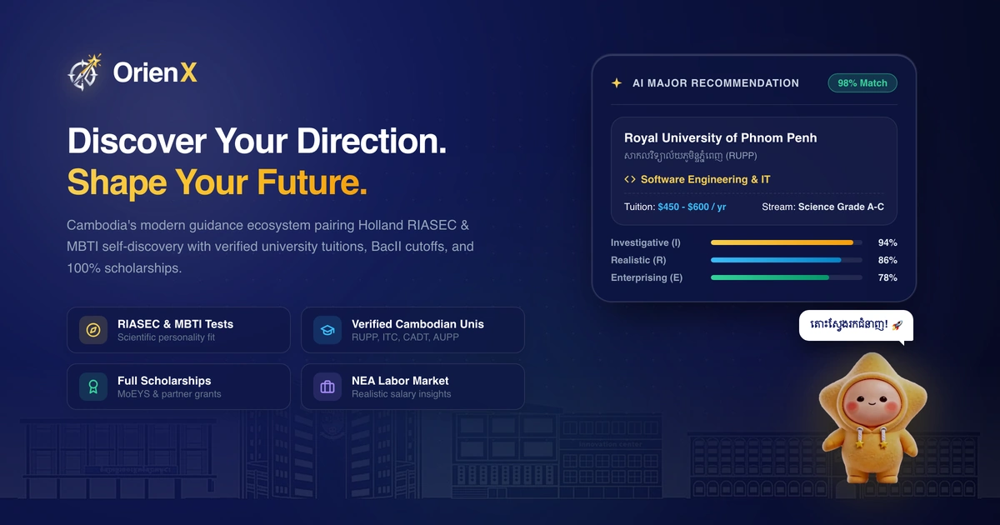
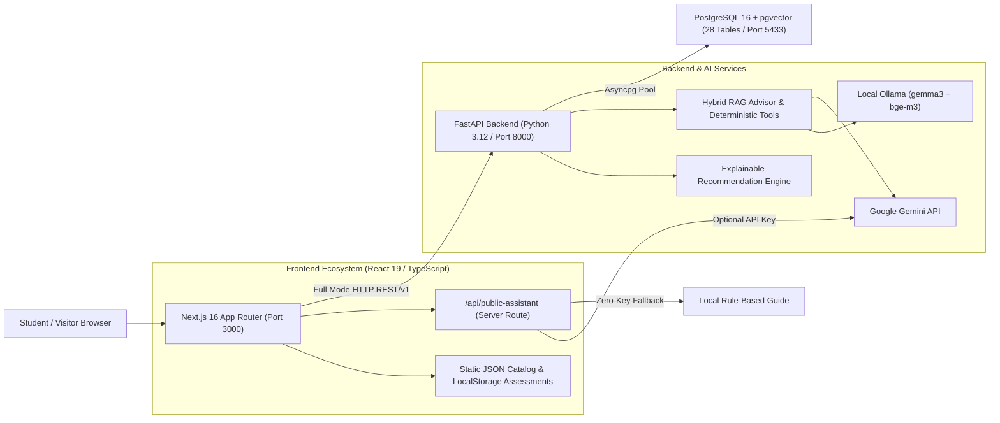

<div align="center">
  <picture>
    <source media="(prefers-color-scheme: dark)" srcset="frontend/public/images/orienx-mark-dark.png" />
    <source media="(prefers-color-scheme: light)" srcset="frontend/public/images/orienx-mark.png" />
    
  </picture>

  <h1>OrienX — Complete Education & Career Guidance Platform for Cambodia</h1>

  <p>
    <strong>"Discover Your Direction. Shape Your Future."</strong><br />
    <em>ស្វែងរកទិសដៅរបស់អ្នក។ កំណត់អនាគតរបស់អ្នក។</em>
  </p>

  <p>
    
  </p>
</div>

**OrienX** is a modern, responsive, full-stack student guidance ecosystem engineered for Cambodian high school students, Grade 12 graduates, and university undergraduates. Moving beyond basic quiz tools and passive directories, OrienX pairs psychometric self-discovery (MBTI-inspired & Holland RIASEC assessments) with an explainable recommendation engine and verified Cambodian higher education data.

---

## 🧭 Brand Identity, Mascot & Design System

<table align="center">
  <tr>
    <td align="center" width="220">
      
      <br />
      <strong>Tara (តារា)</strong>
      <br />
      <sub>Official OrienX Guidance Buddy</sub>
    </td>
    <td>
      <strong>Tara</strong> is OrienX's interactive star companion who guides students through personality &amp; RIASEC assessments, reacts to choices in real time, and powers the grounded bilingual guidance assistant across public and dashboard pages.
    </td>
  </tr>
</table>

| Element | Specification | Visual Role |
| :--- | :--- | :--- |
| **Primary Navy** | `#111965` / `#080D2B` | Navigation, headers, brand accents, dark surfaces |
| **Accent Yellow** | `#F7CE4D` / `#F69D0D` | Action buttons (CTAs), active states, badges, highlights |
| **Emerald Growth** | `#33A474` | Scholarships, match scores, success indicators |
| **Canvas Background** | `#F5F6FA` | Light-mode app workspace, dashboard backing |
| **Surface White** | `#FFFFFF` | Cards, forms, comparison matrices, modals |
| **Primary Text** | `#171A2C` | High-contrast body copy & headings |
| **Secondary Text** | `#68708A` | Subtitles, helper text, metadata |
| **Border** | `#E6E8F0` | Structural dividers & card boundaries |
| **Khmer Font** | `Noto Sans Khmer` | Authentic Cambodian typography |
| **English Font** | `Plus Jakarta Sans` / `Inter` | Modern high-density startup UI |

---

## 🏛️ Verified Cambodian Higher Education Benchmark

OrienX strictly uses fact-verified institutional data reflecting actual tuition fees and academic standards across public, semi-public, and private universities in Cambodia:

* **Royal University of Phnom Penh (RUPP / ស.ភ.ភ):** Public institution established in 1960. Tuition: **$250 – $900/year** (Information Technology: $450/yr; Civil Engineering: $600/yr; International Relations: $400/yr).
* **Institute of Technology of Cambodia (ITC / តិចណូ):** Semi-public French-accredited STEM leader founded in 1964. Tuition: **$600 – $800/year** (Software & Information Engineering: $650/yr; Structural Civil Engineering: $750/yr).
* **American University of Phnom Penh (AUPP / អេយូប៊ីភី):** U.S.-accredited private university founded in 2013 (dual degrees with Univ. of Arizona & Fort Hays). Tuition: **$6,000 – $9,000/year** (Software Engineering: $6,000/yr; Business Administration: $6,000/yr).
* **Paragon International University (ParagonIU):** Private English-medium university. Tuition: **$2,500 – $3,500/year**.
* **National University of Management (NUM):** Public business university. Tuition: **$450 – $650/year**.

---

## ⚡ Core Architecture & Technology Stack

OrienX supports both a **Static Guest Mode** (`NEXT_PUBLIC_APP_MODE=static` for zero-backend Vercel deployments) and a decoupled **Full-Stack Mode** (`NEXT_PUBLIC_APP_MODE=full` with Next.js + FastAPI + PostgreSQL/`pgvector`):



### Frontend (`/frontend`)
- **Framework:** Next.js 16 (App Router) with React 19 and TypeScript.
- **Styling & Motion:** Tailwind CSS, HeroUI, GSAP + ScrollTrigger, Motion, and OrienX custom design tokens.
- **Data Fetching:** TanStack Query v5 (`@tanstack/react-query`) in full mode; committed static JSON + `localStorage` persistence in static mode.
- **Visualizations:** Recharts (interactive 6-axis Holland RIASEC radar charts and analytics).
- **Icons & Effects:** Lucide React icons & Canvas Confetti celebration feedback.
- **Bilingual i18n:** Built-in reactive English (`en`) and Khmer (`km`) language context with full vocabulary dictionaries.
- **SEO:** Dynamic `sitemap.xml`, `robots.txt`, `manifest.webmanifest`, JSON-LD Schema.org structured data, and custom WebP Open Graph card.

### Backend (`/backend`)
- **API Framework:** FastAPI with Pydantic v2 validation.
- **ORM & Migrations:** SQLAlchemy 2.0 Async with `asyncpg` connection pooling and Alembic migrations.
- **Security & Crypto:** Argon2id password hashing, PyJWT access tokens (15-min lifetime) with rotating refresh tokens (7-day lifetime), and Role-Based Access Control (`STUDENT`, `ADMIN`, `SUPER_ADMIN`).
- **Recommendation Engine:** Rule-based explainable algorithm scoring majors across Personality ($w_P=0.20$), RIASEC Holland Code ($w_R=0.35$), Academic Aptitude ($w_A=0.30$), and Career Goals ($w_C=0.15$).

---

## 🚀 Quickstart & Setup Guide

### Option 1: Static Guest Mode (Frontend Only / Vercel)

Run the platform without PostgreSQL or FastAPI using the bundled Cambodian catalog and browser-local assessments:

```bash
cd frontend
cp .env.example .env
# Ensure NEXT_PUBLIC_APP_MODE=static (optionally set GEMINI_API_KEY for live Tara AI chat)
npm install
npm run dev
```

Visit [http://localhost:3000](http://localhost:3000).

---

### Option 2: One-Click Full Stack via Docker Compose

Make sure Docker and Docker Compose are installed and running on your machine:

```bash
# 1. Clone repository
git clone https://github.com/Vuthy-Tourn/orienx.git
cd orienx

# 2. Launch complete stack (PostgreSQL + FastAPI + Next.js)
docker compose up --build
```

Access the platform:
- **Frontend App:** [http://localhost:3000](http://localhost:3000)
- **Backend API & Swagger Docs:** [http://localhost:8000/docs](http://localhost:8000/docs)
- **API Health Check:** [http://localhost:8000/api/v1/health](http://localhost:8000/api/v1/health)

---

### Option 3: Local Full-Stack Development Setup

#### 1. Start the PostgreSQL Container
```bash
docker compose up -d postgres
```
*(Runs PostgreSQL 16 with `pgvector` on port `5433`)*

#### 2. Configure and Start Backend
```bash
cd backend

# Create virtual environment and activate
python3.12 -m venv venv
source venv/bin/activate

# Install dependencies
pip install -r requirements.txt

# Run database migrations
alembic upgrade head

# Seed verified Cambodian educational data & demo accounts
python scripts/seed_data.py

# Launch FastAPI development server
uvicorn app.main:app --host 0.0.0.0 --port 8000 --reload
```

#### 3. Configure and Start Frontend
```bash
cd frontend

# Set NEXT_PUBLIC_APP_MODE=full and BACKEND_INTERNAL_URL=http://127.0.0.1:8000 in .env
npm install
npm run dev
```

Visit [http://localhost:3000](http://localhost:3000) in your browser.

---

## 🔑 Pre-Seeded Demonstration Accounts *(Full Mode)*

| Role | Email Address | Password | Pre-Configured State |
| :--- | :--- | :--- | :--- |
| **Student** | `student@futera.edu.kh` | `StudentPass123!` | Complete profile, completed MBTI (`ESTJ`), completed RIASEC (`RIA`), recommendations generated, saved favorites. |
| **Administrator** | `admin@futera.edu.kh` | `AdminPass123!` | Access to `/admin`, platform metrics, live recommendation weight tuner, user directory. |
| **Super Admin** | `superadmin@futera.edu.kh` | `SuperAdmin123!` | System settings, permission controls, and audit trails. |

*(The login screen features one-click quick-fill buttons for both Student and Admin accounts for instantaneous testing)*

---

## 🤖 Zero-Cost AI Advisor & Public Mascot Assistant

OrienX ships two complementary AI guidance flows:

1. **Public Mascot Assistant (`/api/public-assistant` in Static Mode):**
   - Grounded in the verified static catalog (46 universities, 57 majors, scholarships, and local assessment context).
   - Uses `GEMINI_API_KEY` server-side if configured, and automatically falls back to the local rule-based guide if the key is omitted or rate-limited. See [`docs/public-assistant-gemini.md`](docs/public-assistant-gemini.md).
2. **Full-Stack Advisor (`/dashboard/advisor` in Full Mode):**
   - **Local model mode:** Uses [Ollama](https://ollama.com) (`gemma3` + `bge-m3`) with zero API keys and zero per-token cost.
   - **Retrieval-only mode:** If Ollama is not installed, answers directly from verified PostgreSQL records.

Retrieval is **hybrid**: local `bge-m3` embeddings in PostgreSQL via `pgvector` are blended with the keyword/Khmer n-gram scorer, then grounded with deterministic tools:

- `search_universities` — filter by major, province, or budget
- `compare_universities` — compare tuition and program fees
- `check_eligibility` — compare a BACII grade against published admission requirements

Every question, grounded answer, source list, tools used, latency, and optional thumbs-up/down feedback is stored in `ai_interactions`. Export it as JSONL whenever you have enough rows:

```bash
cd backend
source venv/bin/activate
python scripts/export_ai_training_data.py --output data/ai_training_data.jsonl
```

Thumbs-down answers are excluded; unrated ones are kept. The output uses the standard `messages` chat format accepted by Unsloth, TRL, and Axolotl.

### Enable the local model (optional, free)

```bash
# 1. Install Ollama from https://ollama.com (macOS / Windows / Linux)

# 2. Pull a chat model and the local embedding model. gemma3:12b is the best
#    balance for a 16 GB+ Apple Silicon machine; gemma3:4b or qwen2.5:3b are
#    lighter alternatives for low-memory laptops.
ollama pull gemma3:12b
ollama pull bge-m3

# 3. Make sure the Ollama service is running (the desktop app does this
#    automatically; otherwise run: ollama serve)

# 4. Apply the pgvector migration, build the embedding index, and restart
cd backend
source venv/bin/activate
alembic upgrade head
python scripts/sync_knowledge_embeddings.py
uvicorn app.main:app --reload --port 8000
```

Re-run `python scripts/sync_knowledge_embeddings.py` whenever catalogue records change. If `bge-m3` is unavailable, retrieval automatically falls back to keyword-only mode.

If you use Docker Compose, rebuild after changing dependencies: `docker compose build backend && docker compose up -d`.

The advisor auto-detects any installed chat model. To pin one explicitly, set it in `backend/.env`:

```env
AI_OLLAMA_MODEL=gemma3:12b
# AI_OLLAMA_BASE_URL=http://127.0.0.1:11434
# AI_ADVISOR_ENABLED=true
# AI_DAILY_QUESTION_LIMIT=80
# AI_EMBEDDING_MODEL=bge-m3
# AI_HYBRID_RETRIEVAL=true
# AI_TOOLS_ENABLED=true
# AI_MAX_CONTEXT_DOCS=4
# AI_MAX_CONTEXT_CHARS=3500
# AI_MAX_OUTPUT_TOKENS=180
# AI_OLLAMA_KEEP_ALIVE=2h
# GEMINI_API_KEY=
# GEMINI_MODEL=gemini-3.1-flash-lite
# ASSISTANT_DAILY_QUESTION_LIMIT=40
```

The web UI uses the streaming endpoint, so the first words appear in about a second even when the full answer takes longer. On an M4 Pro with `gemma3:12b`, typical answers finish in 4–9 seconds after the model is loaded. Keeping the model warm (`AI_OLLAMA_KEEP_ALIVE`) removes the cold-start delay; use `gemma3:4b` if you prefer lower latency over reasoning quality.

Khmer answers are script-checked before they reach the browser. If the local model leaks Thai characters, it is asked once to rewrite in Khmer Unicode only; if Thai remains, OrienX returns the verified Khmer fallback. Khmer responses are therefore buffered rather than token-streamed.

The Docker Compose stack uses the `pgvector/pgvector:pg16` image. The backend container already points at `host.docker.internal:11434`, so native Ollama on your Mac is detected automatically.

### Evaluation and training data

| Command | Purpose |
| :--- | :--- |
| `python scripts/generate_advisor_eval_set.py` | Regenerate the 100-question evaluation set from the current catalogue |
| `python scripts/evaluate_advisor.py` | Fast retrieval/tool evaluation (hybrid search, no model calls) |
| `python scripts/evaluate_advisor.py --with-model --limit 10` | Sample generated-answer evaluation |
| `python scripts/export_ai_training_data.py` | Export approved logs as chat-format JSONL |
| `python scripts/check_training_readiness.py` | Gate fine-tuning until 500+ good examples exist |

Fine-tuning is deliberately gated. See `backend/training/README.md` for the QLoRA recipe; facts stay in PostgreSQL, not in the model weights.

The included baseline report is `backend/data/eval/reports/advisor_eval_baseline.json` — 100/100 on source hit, tool routing, must-include facts, and refusal behavior in hybrid retrieval-only mode.

### API

| Method | Endpoint | Purpose |
| :--- | :--- | :--- |
| `POST` | `/api/public-assistant` | Grounded Gemini / local fallback answer for static guest mode |
| `GET` | `/api/v1/ai/status` | Detects whether a local model is available |
| `POST` | `/api/v1/ai/advisor` | Ask a question (authenticated, full JSON response) |
| `POST` | `/api/v1/ai/advisor/stream` | Same question, streamed as Server-Sent Events |
| `GET` | `/api/v1/ai/assistant/status` | Whether the Gemini floating assistant is configured |
| `POST` | `/api/v1/ai/assistant` | Grounded Gemini answer for the floating widget |
| `POST` | `/api/v1/ai/interactions/{id}/feedback` | Record whether an answer helped |

### Floating Gemini assistant

A small mascot assistant appears at the bottom-right of public and dashboard pages (hidden on login, admin, and the full advisor page). It uses the same verified retrieval and tools, then asks Gemini to phrase the answer.

1. Create an API key in Google AI Studio.
2. Add it to `frontend/.env` (static mode) or `backend/.env` (full mode) — **never** in a `NEXT_PUBLIC_*` variable:

```env
GEMINI_API_KEY=your-key-here
GEMINI_MODEL=gemini-3.1-flash-lite
```

3. Restart the server.

The key is only read on the server. `.env` files are gitignored and excluded from Docker builds; Compose reads `backend/.env` at runtime. If the key is missing, invalid, or Gemini is temporarily down, the widget falls back to the deterministic verified-data answer instead of failing. Gemini usage is billed by Google; the local Ollama advisor remains free.

---

## 🧪 Running Automated Tests

Run backend integration and unit tests with Pytest:

```bash
cd backend
source venv/bin/activate
pytest -v
```

All test suites verify authentication tokens, RBAC permission barriers, assessment calculation math, and explainable recommendations.

---

## 🗄️ Database Entity Overview

OrienX models a comprehensive relational schema:
1. `users`, `refresh_tokens`, `student_profiles`
2. `universities`, `faculties`, `majors`, `university_majors`
3. `careers`, `major_careers`, `scholarships`
4. `personality_questions`, `personality_options`, `personality_results`, `personality_dimension_scores`
5. `riasec_questions`, `riasec_results`, `riasec_dimension_scores`
6. `academic_preferences`
7. `major_recommendations`, `recommendation_weights_config`
8. `favorite_majors`, `favorite_universities`, `favorite_scholarships`
9. `admin_audit_logs`
10. `ai_interactions`
11. `knowledge_embeddings` (`pgvector`, 1024 dimensions)

---

## 📄 License & Attribution

Developed with pride for the students of Cambodia.  
Built with Next.js, FastAPI, PostgreSQL, and Tailwind CSS.
